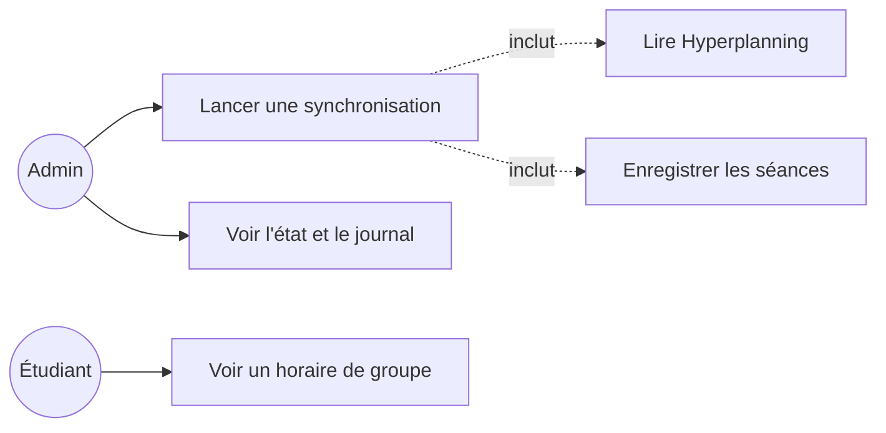
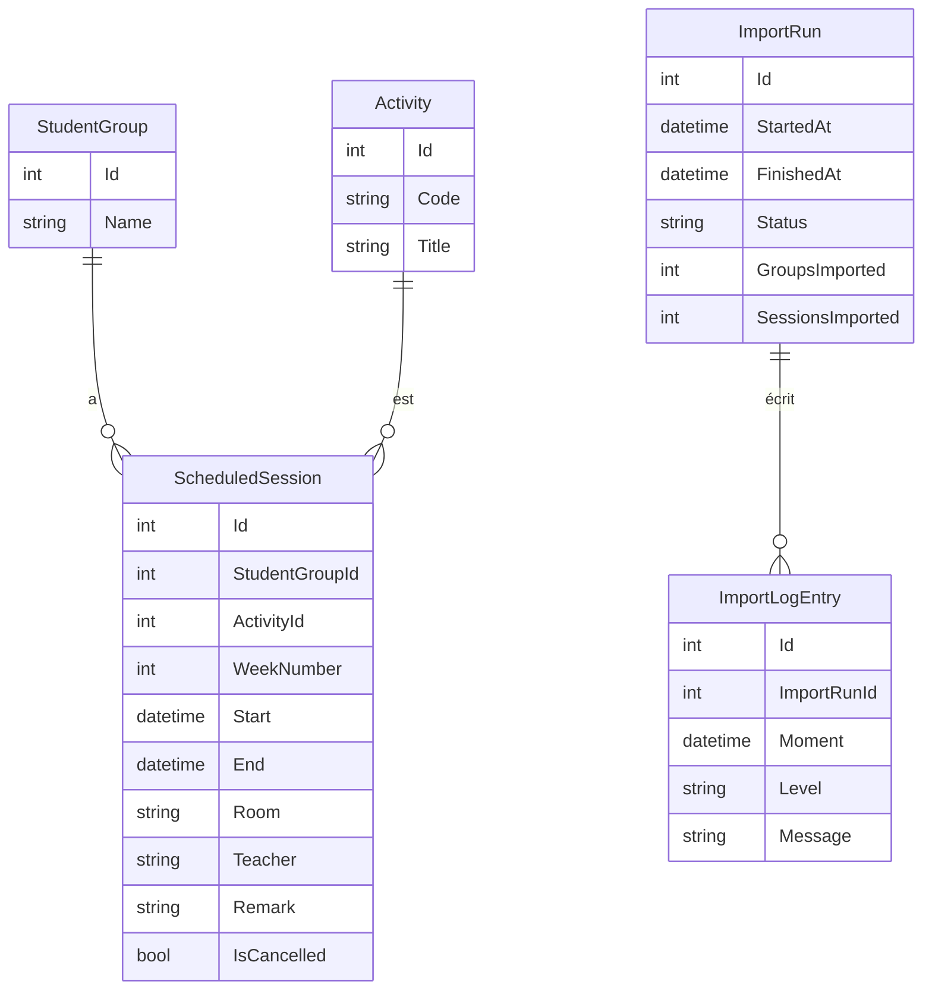
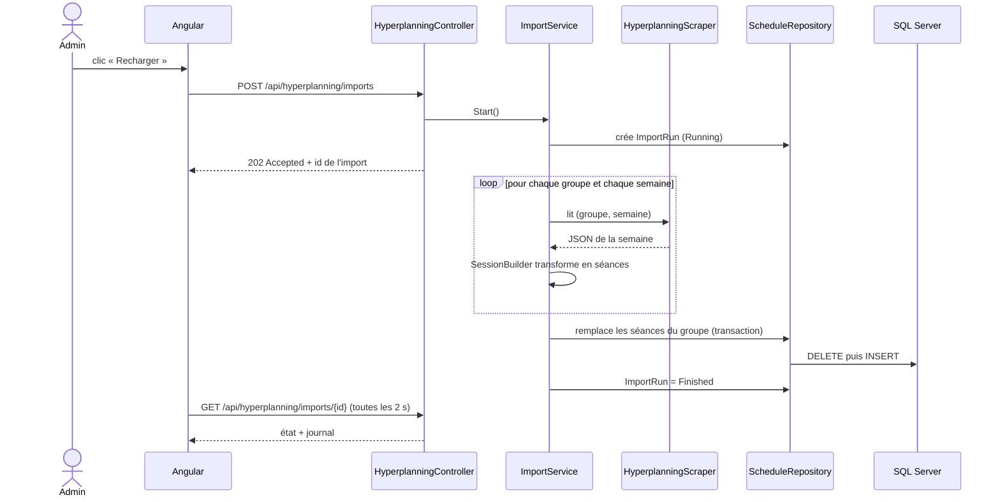

# GroupSwitch — Scraping Hyperplanning

## 1. But
Lire l'horaire d'invité de Hyperplanning (une fois par quadrimestre,
quand l'admin clique sur un bouton) et le ranger dans SQL Server.

## 2. Structure du dépôt
GroupSwitch/
├── .github/workflows/ci.yml
└── GroupSwitch/
    ├── 0 docs/
    ├── 1 frontend/                (Angular)
    └── 2 backend/
        ├── GroupSwitch.Api/       Controllers, Program.cs
        ├── GroupSwitch.Business/  Règles métier, scraping (interfaces + services)
        ├── GroupSwitch.Data/      Entités, DbContext, Repositories, migrations
        └── GroupSwitch.Tests/     Tests automatiques

Règle : Api → Business → Data. Une couche appelle seulement celle du dessous.

## 3. Cas d'utilisation (use cases)

## 4. Les données (entités et relations)

| Table | Rôle | Clé / index |
|---|---|---|
| StudentGroup | un groupe (ex. IODA B3) | Name unique |
| Activity | un cours (code Hyperplanning) | Code unique |
| ScheduledSession | une séance datée | index (StudentGroupId, Start) |
| ImportRun | une exécution de l'import | un seul « Running » à la fois |
| ImportLogEntry | une ligne de journal | index ImportRunId |

On ne stocke jamais l'id de session ni les `N` de Hyperplanning : ils
changent à chaque visite. On retrouve les groupes par leur **nom**.

## 5. Ce qu'on sait de Hyperplanning
- Une réponse `FonctionEmploiDuTemps` = **une semaine d'un groupe**.
  Donc une requête par (groupe, semaine).
- Le `numeroOrdre` de chaque requête est calculé par la page :
  on utilise Playwright (vrai Chromium) au lieu d'appeler l'API à la main.
- Calcul de la date d'une séance :
  - jour = p / 56
  - créneau = p % 56
  - début = lundi(semaine) + jour + 08:00 + 15 min × créneau
  - fin = début + 15 min × d
  - lundi(semaine) = 14/09/2026 + 7 × (semaine − 1)
- Quadrimestre 1 = semaines 1 à 14.

## 6. Diagramme de séquence

## 7. Design patterns utilisés
| Pattern | Où | Pourquoi |
|---|---|---|
| Repository | IScheduleRepository | Le service ne connaît pas EF Core |
| Injection de dépendances | Program.cs | On remplace le vrai scraper par un faux dans les tests |
| Itérateur (`yield return`) | IHyperplanningScraper | Un résultat dès qu'une semaine est lue |
| Délégué / lambda | `Func<int, bool> isWeekWanted` | Choisir le quadrimestre sans changer le code |
| Options | HyperplanningSettings | Pas de constante magique dans le code |

## 8. Clean code (nos règles)
- Pas de `null` : on renvoie une collection vide ou une chaîne vide.
- Pas de commentaires : des noms clairs.
- Pas de constantes magiques : tout dans `ScheduleConstants`.
- Une méthode = une seule chose, 15 lignes maximum.
- Logique pure (calcul de dates) séparée du réseau → facile à tester.

## 9. Découpage en pièces (une branche chacune)
| Pièce | Branche | Contenu | Test |
|---|---|---|---|
| S1 | feature/scraping-data | Entités, DbContext, migration | SQLite en mémoire |
| S2 | feature/scraping-parsers | Lire le JSON (groupes, semaines, cours) | JSON d'exemple |
| S3 | feature/scraping-sessions | SessionBuilder (calcul des dates) | cas connus |
| S4 | feature/scraping-repository | Remplacer les séances d'un groupe | SQLite |
| S5 | feature/scraping-playwright | Scraper Playwright | test « Online » |
| S6 | feature/scraping-service | ImportService + journal | faux scraper |
| S7 | feature/scraping-api | Controller + 202/409 | test d'intégration |
| S8 | feature/scraping-ui | Page Synchronisation | — |
| A1–A4 | feature/auth-… | Identity, JWT, rôles, Angular | 401/403 |

Chaque pièce : branche → code + tests → push → Pull Request → CI verte → merge.
