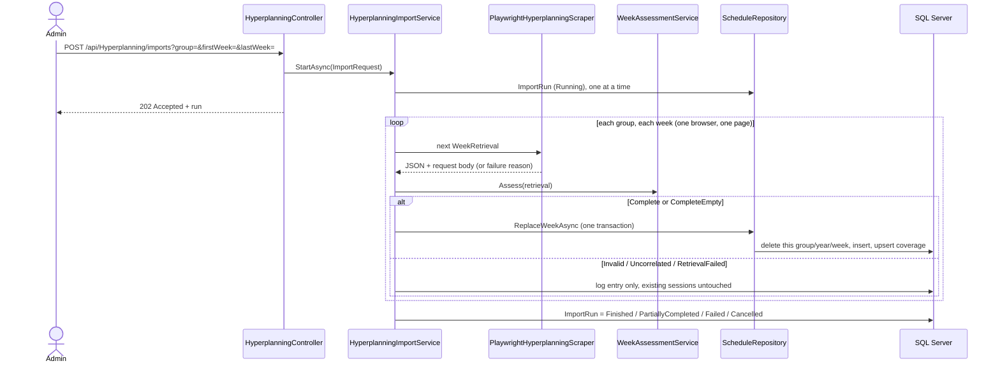
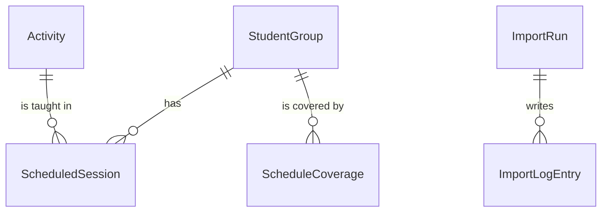

# GroupSwitch — Hyperplanning scraping

Status of this document: written from the code on branch `feature/scraping` and from
imports actually run on 2026-11-09/10 against the real site. Anything not listed under
"Verified results" is not verified.

## 1. Purpose

An Admin starts an import. The backend reads the public guest timetable of
Hyperplanning (`https://planning.helb-prigogine.be/2026-2027/invite`), judges every
week it receives, and stores only weeks proven complete. Students never trigger it.

## 2. Flow

Layers: Api (controllers, DTOs, background worker) → Business (scraping, assessment,
import orchestration) → Data (entities, repositories, migrations).

## 3. What we know about Hyperplanning

- One `FonctionEmploiDuTemps` response holds one week of one group.
- The request body names the group in `donneesSec._Signature_.listeRecherche[0].L`
  and the week in `donneesSec.donnees.Domaine.V` (for example `"[8]"`).
  Observed on weeks 7, 8, 9 and 11 of IODA B3.
- A response is accepted only if its request names the expected group and week.
- Session time: day = `p / 56`, slot = `p % 56`,
  start = Monday(week) + day + 08:00 + 15 min × slot, end = start + 15 min × `d`,
  Monday(week) = 2026-09-14 + 7 × (week − 1). Local Brussels time, no UTC conversion.
- A content of kind 14 holds a sub-group label (for example `A` to `F`). It is not
  stored yet (see limitations).
- Week 7 of the first quadrimester is a holiday for most groups: Hyperplanning answers
  with `"ListeCours":[]` and `"ListeAnnulationsCours":[]`.
- Weeks that the calendar does not offer (for example week 60) are reported as
  "La semaine n'existe pas dans le calendrier."

## 4. Week assessment

| Status | Meaning | Effect |
|---|---|---|
| Complete | schedule response, correlated request, sessions inside the grid, all fields within their column length | week replaced |
| CompleteEmpty | `ListeCours` present and empty | week cleared for this group/year only |
| Invalid | not a schedule, missing `ListeCours`, malformed course, session outside the grid, missing subject, field longer than its column | logged, nothing deleted |
| Uncorrelated | request or sessions belong to another group or week | logged, nothing deleted |
| RetrievalFailed | timeout or page failure | logged, nothing deleted |

A missing `ListeCours` is never treated as an empty week.

## 5. Import behavior

- Weeks are saved one by one. A failure later in the run keeps every week already saved.
- `ReplaceWeekAsync` touches only one group, one academic year and one week, inside one
  transaction, and records the week in `ScheduleCoverages`.
- If saving fails, the change tracker is cleared so the error and the final status can
  still be written. If the run still ends `Running`, the background worker marks it
  `Failed` in a new scope.
- Scraper resilience: a failed week is retried once in a fresh page; a group that failed
  entirely is retried once in a fresh page, then the page is renewed before the next group.
- Safety stop: after 3 groups in a row without any retrieved week, the run stops as
  `Failed` with an explicit log message.
- Cancellation: `POST /api/Hyperplanning/imports/{id}/cancel` stops after the current week
  (`Cancelled`). On restart, runs left `Running` become `Interrupted`.
- Final status: `Finished` (no rejected week), `PartiallyCompleted` (some rejected),
  `Failed` (none saved, unexpected error or safety stop), `Cancelled`, `Interrupted`.

## 6. Data

This is an entity-relationship view of the EF Core model, not Merise notation.

| Table | Key columns and constraints |
|---|---|
| StudentGroups | `Name` (100) unique |
| Activities | `Title` (300) unique |
| ScheduledSessions | `WeekNumber`, `AcademicYear` (20, nullable), `Start`, `End`, `Room` (500), `Teacher` (500), `Remark` (500), `IsCancelled`; index (`StudentGroupId`, `Start`) |
| ScheduleCoverages | unique (`StudentGroupId`, `AcademicYear`, `WeekNumber`), `LastVerifiedAtUtc`, `SessionCount`, `LastImportRunId` (plain id, no foreign key) |
| ImportRuns | `Status`, requested group, academic year, first/last week, successful/rejected weeks, `CancellationRequested` |
| ImportLogEntries | `Level`, `Message` (500) |

Migrations: `AddScheduleCoverage` (new table and columns; sessions without a year were set
to `2026-2027` once), `WidenRoomAndTeacher` (`Room` 100 → 500, `Teacher` 200 → 500).
Both were applied to the local LocalDB database. Neither drops a table or a column.

## 7. API

| Route | Result |
|---|---|
| `POST /api/Hyperplanning/imports?group=&firstWeek=&lastWeek=` | 202 run; 400 unknown/blank group or weeks outside settings; 409 import already running |
| `POST /api/Hyperplanning/imports/{id}/cancel` | 202; 404 unknown; 409 not running |
| `GET /api/Hyperplanning/imports/{id}` | run with successful/rejected week counts and its log; 404 unknown |
| `GET /api/Hyperplanning/imports` | 10 latest runs |
| `GET /api/Hyperplanning/groups` | JSON array of group names read live from Hyperplanning |
| `GET /api/schedules?group=&firstWeek=&lastWeek=` | sessions per week with coverage `Verified`, `VerifiedEmpty` or `Unknown`; 400; 404 group never imported |

Authentication and authorization are not implemented yet on these endpoints.

## 8. Verified results (2026-11-09/10, real site, LocalDB)

- 78 groups listed by Hyperplanning; 78 groups stored, each with 14 covered weeks
  (1 092 coverage rows), weeks 1 to 14, academic year 2026-2027.
- 10 218 sessions, 341 cancelled, 864 activities. Sum of `SessionCount` equals the
  number of stored sessions.
- Week 7 is empty for 69 groups; 9 groups have courses that week (SIAMU, PHOTO B1–B3,
  HBD B1–B3, MSI M1, MSI M2). 4 groups have no course in weeks 1 to 14
  (GERIA FC, SAR IIP, RESTART, AS B3 Module 2).
- No session with `End <= Start`, outside 08:00–22:00, without year or without activity.
  No activity titles differing only by case or spaces.
- IODA B3 weeks 1 to 14: 194 sessions, 2 cancelled, 17 activities, from 2026-09-14 08:00
  to 2026-12-17 17:30; week 8 has 9 sessions with 1 cancelled. Two identical imports gave
  the same result.
- Defects found on the real site and fixed with regression tests:
  the group list was never reopened after the first group (wrong exception type in
  `IsVisibleSoonAsync`); a room longer than 100 characters made SQL Server refuse the week
  and left the run `Running`; a page that degraded during a long run made every later group
  time out.

## 9. Known limitations

- Sub-groups (kind 14, for example `A`–`F`) are not stored: 3 time slots (14 sessions) look
  like exact duplicates although they are distinct sub-group sessions in Hyperplanning.
- The "one import at a time" lock is per process; two API instances on the same database
  are not protected.
- `StartedAt`, `FinishedAt` and log `Moment` are local times; only `LastVerifiedAtUtc` is UTC.
- For runs created before `AddScheduleCoverage`, successful/rejected week counters are 0,
  meaning "not counted", and their scope columns are NULL.
- `GET /api/Hyperplanning/groups` opens a browser on each call (several seconds).
- Tests run on SQLite, which ignores column lengths and does not prove SQL Server behavior.

## 10. Not verified

- An independent comparison with what the Hyperplanning screen displays: the screen reader
  could not open the group list after two attempts.
- Recovery from a degraded page in a real long run (the fix is covered by offline tests only).
- A single full import of all 78 groups after the fixes (the last groups were imported one
  by one).
- The second quadrimester (weeks 15 and later), cancellation and interruption during a real
  import, concurrent API instances, and SQL Server behavior beyond the local LocalDB runs.
